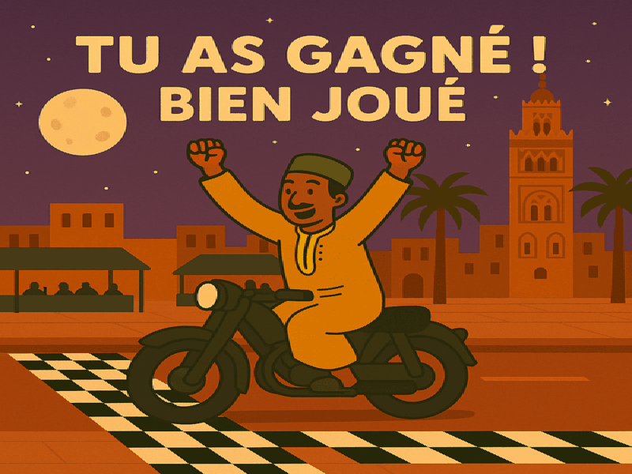

# 🏍️ Game Moto – Jamaa El Fna

A motorcycle game developed in C using SDL2, where the player rides through streets inspired by **Jamaa El Fna Square in Marrakech, Morocco**. This project was created as part of a programming exercise and personal game development learning experience.

---

## 🎮 Features

- Motorcycle controls using the keyboard
- Collision detection
- Animated game elements
- Sound effects and audio support (if SDL_mixer is configured)
- A game environment inspired by the famous Jamaa El Fna Square

---

## 🛠️ Technologies Used

- **Programming Language:** C
- **Libraries:** SDL2, SDL2_image, SDL2_ttf, SDL2_mixer
- **Recommended IDE:** Visual Studio Code

---

## 🚀 How to Run the Project

### 1. Install SDL2

- Download and install SDL2 and the required extensions.
- Configure the headers and libraries in your development environment.
- Make sure the required SDL DLL files are available when running the game on Windows.

### 2. Compile the Project

Example command for Linux:

```bash
gcc main.c -o game -lSDL2 -lSDL2_image -lSDL2_mixer -lSDL2_ttf
```

Run the game:

```bash
./game
```

Make sure the source files and SDL dependencies match your project configuration.

---

## 🖼️ Game Screenshots

### 🏆 Victory Screen



### 🎮 Main Menu


### 💀 Game Over Screen


### 🏍️ Game Interface


### ℹ️ About Page


---

## 👨‍💻 Author

**Oussama Samid**

---

🏍️ *Explore the streets of Marrakech through Game Moto – Jamaa El Fna!*
